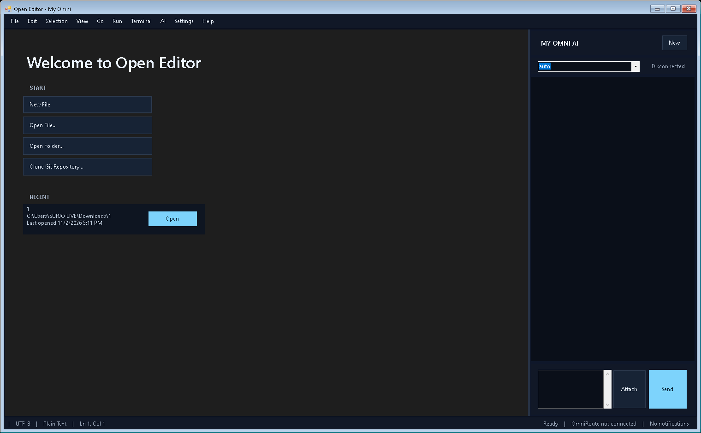

# MY OMNI

MY OMNI is a native Windows coding workbench built with C# and Windows Forms. It combines a source editor, project explorer, workspace search, Git status, protected API-key storage, and an OmniRoute-powered AI assistant without embedding a browser or Electron runtime.

## Download

Download `MyOmni-0.1.0-Windows-x64.exe` from the [latest GitHub release](https://github.com/surjolive/my-omni/releases/latest).

The release executable is self-contained and includes the bundled Node.js runtime and npm CLI. OmniRoute packages are downloaded only when you choose **Install / Start OmniRoute**.

## Screenshot



## Features

- Native Windows source editor with tabs and line numbers
- Lightweight syntax highlighting for C#, JavaScript, TypeScript, Python, JSON, SQL, HTML, XML, CSS, and PowerShell
- Animated Explorer and AI Chat sidebars
- Workspace explorer, filename search, and Git status views
- Untitled files, Save, Save As, and Save All workflows
- OmniRoute chat with model selection and secure Windows DPAPI API-key storage
- Workspace, active-editor, and general chat contexts
- AI tool calls with explicit review before editor or workspace edits
- Command palette, keyboard shortcuts, settings, and recent projects
- Responsive native controls with restrained hover and panel transitions

## Requirements

- Windows 10 or Windows 11
- .NET Framework 4.5 or later
- Internet access only for OmniRoute installation or provider requests

## Run the release

```powershell
Start-Process .\MyOmni-0.1.0-Windows-x64.exe
```

Settings and saved projects are stored in:

```text
%LOCALAPPDATA%\My Omni
```

API keys are stored through Windows DPAPI for the current Windows user. The app never requires an API key in source code or command-line arguments.

## Build from source

Requirements:

- Windows
- PowerShell
- The .NET Framework C# compiler
- Node.js 24.15 or later with npm

Build and package the native executable:

```powershell
powershell -ExecutionPolicy Bypass -File .\build-native.ps1
```

The default output is:

```text
release\MyOmni-0.1.0-Windows-x64.exe
```

Set `MYOMNI_OUTPUT` only when a different approved executable name is required:

```powershell
$env:MYOMNI_OUTPUT = 'MyOmni-Custom.exe'
powershell -ExecutionPolicy Bypass -File .\build-native.ps1
```

## Getting started

1. Open a folder with **File > Open Folder** or `Ctrl+Shift+O`.
2. Open or create a source file.
3. Open **AI > OmniRoute** or **Settings > AI Providers**.
4. Install or start the local OmniRoute gateway.
5. Create a provider API key in the OmniRoute dashboard.
6. Enter the key and select a model in MY OMNI, then choose **Connect**.

MY OMNI cannot create an OmniRoute API key automatically.

## Keyboard shortcuts

| Shortcut | Action |
| --- | --- |
| `Ctrl+N` | New file |
| `Ctrl+O` | Open file |
| `Ctrl+Shift+O` | Open folder |
| `Ctrl+S` | Save |
| `Ctrl+Shift+S` | Save As |
| `Ctrl+B` | Toggle Explorer sidebar |
| `Ctrl+Shift+I` | Toggle AI Chat sidebar |
| `Ctrl+Shift+P` | Open command palette |
| `Ctrl+G` | Go to line |

## AI edit safety

The assistant can read the active editor or files inside an open workspace. Proposed changes remain in review until approved. Approved edits are inserted into editor tabs as unsaved content.

Use **Save** or **Save All** to write approved edits to disk. Workspace content is sent only to the configured OmniRoute provider, so provider data-handling policies should be reviewed before use.

## Troubleshooting

- **Build compiler not found:** confirm that .NET Framework 4 includes `C:\Windows\Microsoft.NET\Framework64\v4.0.30319\csc.exe`.
- **Node.js requirement failed:** Node.js 24.15 or later is required by the native build script.
- **OmniRoute will not install:** check internet access and retry **Install / Start OmniRoute**.
- **Chat is connected but returns no text:** verify the provider, model, and API key in the OmniRoute dashboard.
- **Port 20128 is already used:** stop the existing OmniRoute gateway or resolve the port conflict.
- **Git status is unavailable:** verify that Git is installed and the selected folder is a Git repository.

## Current limits

Code execution, an integrated terminal, an extension host, Ollama transport, and a configured issue tracker are not included in the native build. MY OMNI is a focused Windows workbench, not a full VS Code replacement.

## Architecture

- `MyOmniNative.cs`: native WinForms application, editor, tools, UI, and OmniRoute transport
- `build-native.ps1`: native executable and runtime packaging
- `electron/`, `src/`: source scaffold retained for project architecture context
- `documentation/`: architecture documentation
- `resources/`: icons, themes, images, and screenshots

## Licenses

MY OMNI is dual-licensed under MIT OR Apache-2.0:

- [MIT](LICENSE-MIT.md)
- [Apache-2.0](LICENSE-APACHE.md)
- [License summary](LICENSE.md)

Runtime notices are listed in [THIRD_PARTY_NOTICES.md](THIRD_PARTY_NOTICES.md).
